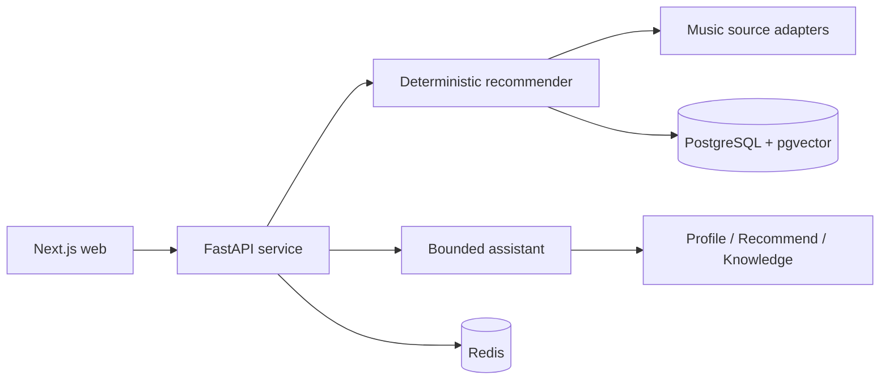

<div align="right">
  English · <a href="README.zh-CN.md">简体中文</a>
</div>

# Sonora

**Explainable music recommendations, with a focused AI assistant.**

[](https://github.com/jiangking22/sonora/actions/workflows/ci.yml)
[](LICENSE)
[](https://nextjs.org/)

Sonora is a full-stack music discovery app built around a transparent recommendation
engine. Enter a song, artist, or mood, and it recalls tracks from multiple catalogs,
ranks them with an explicit scoring policy, and shows why each result was selected.
Accounts keep feedback and preferences in sync across devices, while a bounded assistant
helps users explore their results.

The recommender owns ranking and ordering. The assistant can call a small set of approved
tools and explain their output.

## Preview

<p align="center">
  
</p>

<sub>Fixture-mode preview from a local run. Actual results depend on the configured catalogs.</sub>

## Features

- Multi-source recall with canonical deduplication, explainable scoring, and diversity reranking
- Account-based likes, dislikes, profiles, and cross-device preference sync
- Music assistant with bounded tools, session memory, evidence labels, and a local fallback
- Typed REST/SSE APIs, vector storage, standard MCP tools, and regression evaluation

## Architecture



The stack is Next.js and TypeScript on the front end, FastAPI and Python 3.12 on the
back end, with PostgreSQL/pgvector, Redis, and Docker Compose for local development.
See [Architecture](ARCHITECTURE.md) and [design decisions](DECISIONS.md) for the details.

## Getting started

You only need Docker Compose v2 to run the complete application locally.

```bash
git clone https://github.com/jiangking22/sonora.git
cd sonora
cp .env.example .env
# Windows PowerShell: Copy-Item .env.example .env

# Use the same database password in POSTGRES_PASSWORD and DATABASE_URL.
docker compose up --build --wait --wait-timeout 180
```

Open [http://localhost:3000](http://localhost:3000) and create a local account.
The assistant is available at [http://localhost:3000/agent](http://localhost:3000/agent).

No model key is required. Without one, Sonora uses its local assistant fallback.
For a fully offline catalog demo, set `ENABLE_MUSIC_PROVIDERS=false` in `.env`.

Optional server-side settings are documented in
[`.env.example`](.env.example): `LLM_API_KEY` enables an OpenAI-compatible model, and
`BRAVE_SEARCH_API_KEY` enables optional web clues. Keep credentials in your local
environment. Production configuration and deployment steps are in
[Deployment](docs/DEPLOYMENT.md).

## Tests

Python 3.12 and Node.js 24 are required for the direct test commands.

```bash
cd services/api
python -m venv .venv
# Windows PowerShell: .\.venv\Scripts\Activate.ps1
python -m pip install -e ".[dev,mcp]"
python -m pytest -q
python -m ruff check app tests scripts

cd ../../apps/web
npm ci
npm test
npm run lint
npm run typecheck
npm run build
npm run audit
```

The same API, web, and clean-start gates run in
[GitHub Actions](.github/workflows/ci.yml).

## Project layout

```text
apps/web/       Next.js product and assistant UI
services/api/   FastAPI service, recommendation domain, and tests
docs/           Deployment, demo, evaluation, and design notes
infra/          Local database initialization
```

## Documentation

- [Deployment and configuration](docs/DEPLOYMENT.md)
- [Five-minute demo](docs/DEMO.md)
- [Architecture](ARCHITECTURE.md)
- [Design decisions](DECISIONS.md)
- [Changelog](CHANGELOG.md)

## Limitations

Sonora is a portfolio and engineering demo, not a licensed streaming service. Public
music endpoints may change, and source availability is not guaranteed. The included
evaluation fixtures are regression checks rather than real-user benchmarks.

## License

[MIT](LICENSE) © 2026 jiangking22
