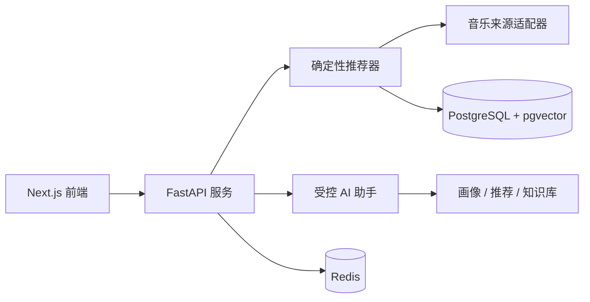

<div align="right">
  <a href="README.md">English</a> · 简体中文
</div>

# Sonora

**可解释的音乐推荐，搭配一个克制的 AI 助手。**

[](https://github.com/jiangking22/sonora/actions/workflows/ci.yml)
[](LICENSE)
[](https://nextjs.org/)

Sonora 是一个基于透明推荐引擎的全栈音乐发现应用。输入歌曲、歌手或心情后，它会从多个
曲库召回候选歌曲，按照明确的评分策略排序，并展示每首歌的推荐理由。账号会同步喜欢、
不喜欢和偏好画像，AI 助手则帮助用户继续探索推荐结果。

推荐顺序由推荐器决定。AI 助手只能调用有限的一组工具，并解释这些工具返回的结果。

## 预览

<p align="center">
  
</p>

<sub>本地固定曲库模式截图。实际结果取决于所配置的音乐来源。</sub>

## 功能

- 多来源召回、统一去重、可解释评分与多样性重排
- 基于账号的喜欢、不喜欢、偏好画像和跨设备同步
- 带工具调用、会话记忆、依据标注和本地降级能力的音乐助手
- 类型化 REST/SSE 接口、向量存储、标准 MCP 工具与回归评估

## 架构



前端使用 Next.js 和 TypeScript，后端使用 FastAPI 和 Python 3.12，数据层采用
PostgreSQL/pgvector 与 Redis，本地开发通过 Docker Compose 启动。更多信息见
[架构说明](ARCHITECTURE.md)和[设计决策](DECISIONS.md)。

## 快速开始

本地运行完整应用只需要 Docker Compose v2。

```bash
git clone https://github.com/jiangking22/sonora.git
cd sonora
cp .env.example .env
# Windows PowerShell: Copy-Item .env.example .env

# POSTGRES_PASSWORD 与 DATABASE_URL 中的数据库密码需要保持一致。
docker compose up --build --wait --wait-timeout 180
```

打开 [http://localhost:3000](http://localhost:3000) 并注册本地账号。
音乐助手位于 [http://localhost:3000/agent](http://localhost:3000/agent)。

没有模型密钥时，Sonora 会使用本地助手降级模式。若要进行完全离线的固定曲库演示，
请在 `.env` 中设置 `ENABLE_MUSIC_PROVIDERS=false`。

可选的服务端配置见 [`.env.example`](.env.example)：`LLM_API_KEY` 用于启用
OpenAI 兼容模型，`BRAVE_SEARCH_API_KEY` 用于可选的网页线索检索。请只在本地环境变量中
保存密钥。生产配置与部署步骤见[部署说明](docs/DEPLOYMENT.md)。

## 测试

直接运行测试需要 Python 3.12 和 Node.js 24。

```bash
cd services/api
python -m venv .venv
# Windows PowerShell: .\.venv\Scripts\Activate.ps1
python -m pip install -e ".[dev,mcp]"
python -m pytest -q
python -m ruff check app tests scripts

cd ../../apps/web
npm ci
npm test
npm run lint
npm run typecheck
npm run build
npm run audit
```

相同的 API、Web 和干净启动检查会在
[GitHub Actions](.github/workflows/ci.yml)中运行。

## 项目结构

```text
apps/web/       Next.js 产品界面与助手
services/api/   FastAPI 服务、推荐领域代码与测试
docs/           部署、演示、评估与设计文档
infra/          本地数据库初始化
```

## 文档

- [部署与配置](docs/DEPLOYMENT.md)
- [五分钟演示](docs/DEMO.md)
- [架构说明](ARCHITECTURE.md)
- [设计决策](DECISIONS.md)
- [变更记录](CHANGELOG.md)

## 已知限制

Sonora 是一个作品集与工程演示项目，并非获得授权许可的流媒体服务。公开音乐接口可能
发生变化，无法保证音乐来源始终可用。仓库中的评估样本用于回归检查，并非真实用户基准。

## 许可证

[MIT](LICENSE) © 2026 jiangking22
